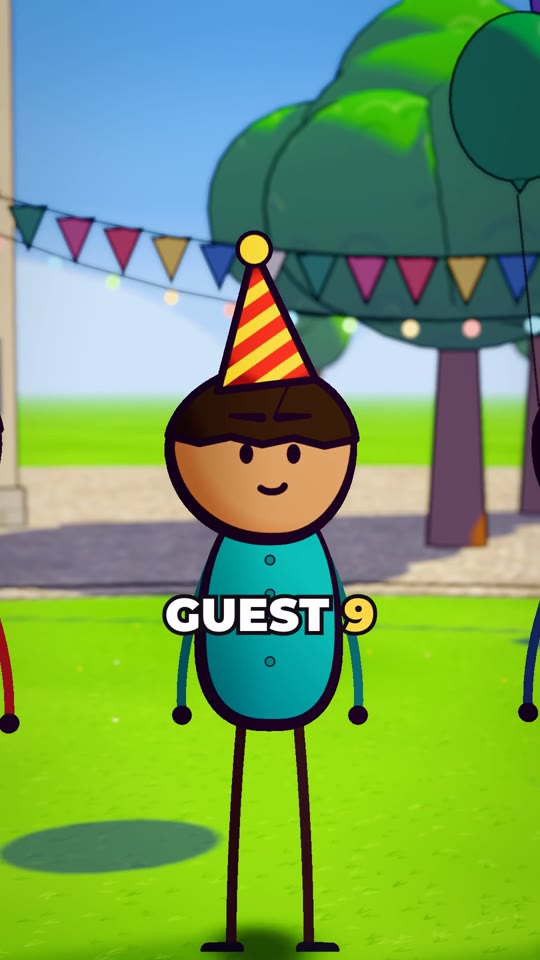

# The Birthday Bet: a birthday-paradox short made with this skill

**Watch:** [`birthday_paradox_short.mp4`](birthday_paradox_short.mp4) (burned-in captions). The source here is v3, "Would you take this bet?" (55 s). The MP4 is still the v1 cut (68 s, one narrator) until the v3 render is committed. The QA record is in [`qa_report.md`](qa_report.md).



A 55 s vertical short (1080x1920, 30 fps) about the birthday paradox. Dave dares the camera, "Twenty-three people. I bet
two of them share a birthday", the whole party bets against him, and the viewer is asked whether they would too. The
answer (a coin flip) is withheld until second 37. `SCRIPT.md` has the script, the sources and why v3 replaced v1.
It is built from `templates/bridge/` and `templates/audio/`, with these additions:
- **Burned-in captions** (`Captions.tsx`) so the short works with the sound off. They show 1-4 word chunks, numbers as
  digits, key words in yellow and a name tag over dialogue, timed to `words.json`.
- **Story graphics for the sound-off viewer** (`Overlay.tsx`): the hook title, Dave's $100 bill slapping the lens, a
  "$2,200 AT RISK" pill that flips to "DAVE WINS", a live "CHECKED n/23 · MATCHES 0" counter during the roll call, the
  "253 = 253" twist card, screen-space confetti cannons and the "COMMENT YOUR BIRTHDAY" call to action.
- **A record-scratch freeze-frame** after "September ninth!": `<Freeze>` holds the 3D layers, desaturated, with a creeping
  zoom and a white flash.
- **Every cue comes from the voice.** `story.ts` looks shots, camera keys and acting beats up by word (`cue(line, "word")`),
  so re-voicing a line moves its pictures with it. `scripts/dump-timeline.mjs` exports the same timeline for the sound.
- **New world** (`world.ts`, `build.ts`):
  - a town square around a party lawn: table, cake with candles, balloons, bunting, string lights and a banner;
  - the glowing web of birthday pairs, which shows Gary's 22 lines, then all 253 pairs, then 50 and 70 people;
  - a 3D gold coin, confetti, and a football stadium for the 2014 World Cup fact.
- **New cast pieces** (`toon.ts`, `cast.ts`):
  - party hats, glasses, jersey numbers;
  - wink, sad and talk faces, and mouth flaps while a character's line is mid-word;
  - cheer, cash, fan-of-cash, palm and a slow raise-a-hand pose;
  - number tags, speech bubbles, calendar pages, "?" marks, cricket chirps and sparkles.
- **Four voices with timings:** Kokoro-82M TTS (`voice/gen_voice.py`, Apache-2.0 model): narrator `am_michael`, Dave
  `am_fenrir`, Gary `am_onyx`, guest 17 `af_bella`, picked by measured pitch (121 / 148 / 92 / 202 Hz) so they read as
  four people, and level-matched per line. Word timings come from the TTS itself and were checked against Whisper (median
  offset 0.004 s).
- **Sound** (`audio/sound.py`):
  - an original score whose sections follow the picture (a ticking tension pulse under the roll call that the record
    scratch kills), ducked under the voice;
  - about 70 synthesized SFX cues (lens slap, cash riffle, counter ticks, record scratch, crickets, confetti cannons...);
  - a master at -14.5 LUFS and -1 dBTP.
  `audio/levels.py` is an objective level check, for containers where nobody can listen.

## Facts and sources
See `SCRIPT.md`. In short:
- 23 people give a 50.7 % chance of a match, from 253 pairs.
- For a coin-flip chance that someone shares one given birthday, you need 253 other people.
- In 2014, 16 of the 32 World Cup squads of 23 had a shared birthday (BBC).

## Build (Linux, no GPU)
```bash
npm install && npm run fonts                                # Remotion 4 + R3F 9 + postprocessing, fonts into public/
python voice/gen_voice.py                                   # needs `pip install kokoro soundfile` (Python <= 3.12)
cp voice/words.json src/videos/birthday/words.json
node scripts/dump-timeline.mjs                              # out/timeline.json
python audio/sound.py && python audio/levels.py             # out/audio/mix.wav (+ stems, cues.md)
node scripts/stills.mjs BirthdayShort out/look/s_ 120,700,1090,1900 0.5
node scripts/render-chunks.mjs 3 0-143,144-294,...          # parallel chunks, resumable
scripts/finish.sh                                           # concat + mux + frame QA -> out/birthday_bet.mp4
```
Chromium uses software WebGL (`gl: "swangle"`). On 4 CPU cores with 3 parallel workers, each worker took 6.5-12 s per
1080p frame. The full 2049 frames rendered in 113 min. Check stills before the full render.

Share encode (the crf 16 master is ~145 MB; this one is 49 MB, so it fits under GitHub's 50 MB warning):
```bash
ffmpeg -i out/birthday_bet.mp4 -c:v libx264 -preset slow -crf 21 -tune animation -maxrate 7M -bufsize 14M \
  -pix_fmt yuv420p -c:a aac -b:a 192k -movflags +faststart out/birthday_paradox_short.mp4
```
